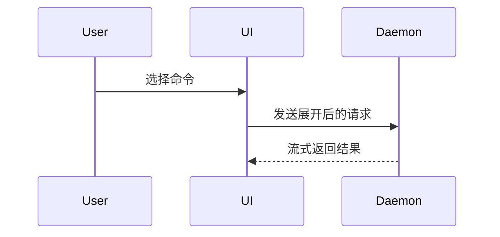

# yjx-show-me

用最小有效可视化视口帮助用户直观理解当前讨论主题。详细的结论先行与文字密度要求见下方《呈现准则》。

评审或修改本 skill 前阅读 [MAINTENANCE.md](MAINTENANCE.md)；普通执行不需要读取它。

## 按主题选择视口

- **解释或走读仓库中已有的代码实现机制（优先组合）**：采用“顶层精简调用树 + 关键真实代码缩写块（保留真实函数签名、核心分支条件与状态读写，省略样板与无关字段）”并紧邻一两句简短说明，让读者直接对齐源码形态，避免仅画 Mermaid 图表或抽象伪代码而脱离真实实现：

```text
SendOrBatchSend (presentation/red-envelope/subscriber.go)
  app.TriggerEvent
    checkActivityPlayStage
    createRedEnvelopeEntity
```

```go
func (s *Service) TriggerEvent(ctx context.Context, roleID int64, eventNo int32) error {
    if !s.activitySvc.InPlayStage(ctx, ActivityTypeRedEnvelope) {
        return nil // 非玩法期直接忽略触发
    }
    cfg := s.staticCfg.GetEvent(eventNo)
    return s.repo.CreateEnvelope(ctx, roleID, cfg.Award, cfg.DurationSec)
}
```

- **尚未落地的算法或纯逻辑推演**：使用极简伪代码：

```text
on(save)
  if content is unchanged
    return cached result
  write new content
  return fresh result
```

- **运行时控制流或调用链总览**：使用缩进调用树：

```text
submitForm
  createSession
    persistPrompt
    launchAgent
  navigateToSession
```

- **UI 组件结构（含关键状态与模块边界）**：使用组件树：

```tsx
<SessionPage> (apps/example/src/routes/session.tsx)
  useSessionEvents()
  <SessionToolbar>
    <RunSkillButton> (packages/ui)
```

- **模块职责或目录重构范围**：使用浅层文件树：

```text
src/
├── commands/       # 解析用户动作
├── sessions/       # 维护会话状态
└── transport/      # 发送接口请求
```

- **跨组件交互、时序或数据流**：使用 Mermaid：



- **已有短小结构化骨架上的局部变更对比**：对组件树、目录树、调用链或简短状态/配置片段使用与主题同构的微型 `diff`；自然语言规则、长段落文档或方案建议的增改直接用结构化正文或列表陈述：

组件变更：

```diff
 <SessionPage>
   useSessionEvents()
   <SessionToolbar>
+    <RunSkillButton />
   <SessionTimeline>
+    <SkillResultCard />
```

目录结构变更：

```diff
 src/
 ├── commands/
+│   └── show-me.ts       # 展开斜杠命令
 ├── sessions/
-└── transport.ts
+└── transport/
+    ├── client.ts
+    └── stream.ts
```

调用链变更：

```diff
 submitForm
   createSession
     persistPrompt
+    expandSkillMention
     launchAgent
-  navigateToSession
+  navigateToSession
+    subscribeToEvents
```

状态或控制流变更：

```diff
 on(save)
-  write content
+  if content is unchanged
+    return cached result
+  write new content
+  invalidate cache
```

- **大部分内容全新、省略上下文会掩盖所有权/顺序、或需要直接复制目标结构**：展示完整代码块：

```ts
function expandSkill(command: string): string {
  const skillName = command.slice(1)
  return `use the ${skillName} skill`
}
```

- **内联视口与 Mermaid 难以承载的多维 UI 布局或高密度状态对比（仅在用户明确要求 HTML/网页展示，或内联代码、调用树与 Mermaid 确实无法表达时启用）**：生成单个聚焦的 HTML 文件（图表、信息图或简短演示页），贴合产品的色彩、字体、间距与真实字段名称，兼顾桌面与移动端，并在当前平台默认浏览器中打开供用户查看；常规代码走读与机制解释默认使用上方内联视口。

## 呈现准则

每个主题首句直接给出核心机制结论或答案，紧接放置支撑它的最小视口。文字只保留理解当前问题或解决当前分歧所需的事实、调用、文件、状态与边界，使用直接动词与字面行动陈述，不写首尾寒暄、过程复盘或空泛黑话（如赋能、闭环、抓手、底层逻辑），展示完毕即停。

按需选用其中一种或几种内联视口组合，不必每次罗列全部形式；保持克制，避免信息过载。
